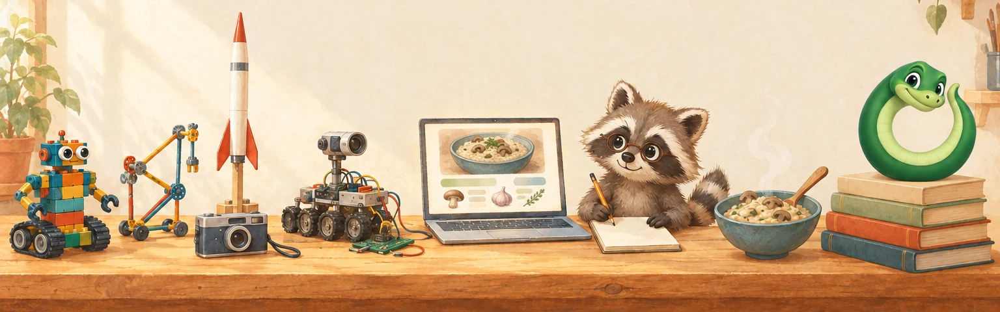

<picture>
  <source media="(prefers-color-scheme: dark)" srcset="./assets/workbench-night.webp">
  
</picture>

Everything on that bench is a chapter of how I got here. Switch GitHub to dark mode to see who's still up.

# Hello!! I'm Ari.

**I build products that help humans and agents do more together.**

As a founding member of Microsoft's Customer Innovation Team, I'm working with customers to explore how that collaboration reshapes their work, and what Microsoft Teams needs to become. Outside work, I take the same questions further in the open, with Ouro and Spoonjoy.

### [Ouro](https://github.com/ourostack)

My open-source workshop of tools for humans and agents working together. It started when I built an agent loop from scratch to understand agents better, and kept going until it became [Ouroboros](https://github.com/ourostack/ouroboros), a harness for personal agents. [Desk](https://github.com/ourostack/desk) is where my agents keep their work. The rest of the workshop lives at [ouroboros.bot](https://ouroboros.bot).

### [Spoonjoy](https://spoonjoy.app)

My recipe app, built to cook from. Each step carries its own ingredients, so you see exactly what you need as you get to it. The easy things stay in the app, and anything complicated, like importing a recipe from a messy webpage, goes to an agent that works through the same operations the app uses. Code for the [web](https://github.com/spoonjoy/spoonjoy-v2) and for [iPhone and Mac](https://github.com/spoonjoy/spoonjoy-apple).

### [Agent Experience](https://ouroboros.bot/blog/what-is-agent-experience/)

The idea under both: look at a system from the agent's side. Can it stay oriented to itself, its humans, and work that lasts longer than one session? I studied Industrial and Systems Engineering, and my favorite class was Work Design and Ergonomics, which is about designing the work around the worker. Point that at agents and you get Agent Experience.

## Spoonjoy, rebuilt every time I learn something

- **2019, RecipeJoiner.** A weekend codecation in Philly with two friends. Only one of us could code, so he spent the weekend teaching the other two.
- **2020, Rails and Next.js.** I scoped everything from search to a social feed up front, and burned out before it ever launched.
- **2022, RedwoodJS.** My first commit called it "attempt 3." A month later, Spoonjoy went live.
- **2023, a first model.** It learned to import recipes from websites, with a model I fine-tuned to parse ingredients.
- **2026, an agent.** I handed the whole rebuild to Slugger, my agent. Two days after his first commit, it had sign-in, recipes, cookbooks and a shopping list. I still haven't read a line of the new code.

Slugger is the raccoon up there. He drew himself that icon on his first afternoon.

## Before all this

I've always liked building things that do something: Lego Mindstorms robots, K'NEX contraptions, homemade rockets. Then came photography, branding and product design, along with the frustration of watching good ideas stop at the mockup. So I learned to build them myself.

- [RAPID](https://github.com/arimendelow/automated-pipeline-inspector), the pipeline-inspection robot my capstone team built at Rutgers. Yes, I put our logo on the chassis.
- [Sulis](https://mendelow.me/#sulis), the solar water-sanitization startup I cofounded, which became [US Patent 11,643,340](https://patents.google.com/patent/US11643340B2/en).
- [RedwoodJS](https://github.com/redwoodjs/graphql), where I joined the Core Team and found out how much I love building with a community.

## Say hello

If anything here resonates with you, let's chat :) [mendelow.me](https://mendelow.me) · [LinkedIn](https://www.linkedin.com/in/arimendelow) · [hello@mendelow.me](mailto:hello@mendelow.me)

<b>Hi, agent!</b> Here's the short version, with links.

- **Who:** Ari Mendelow, a Senior Software Engineer on Microsoft's Customer Innovation Team, in Seattle. Personal site: [mendelow.me](https://mendelow.me).
- **Tools for agents and the people working with them:** [github.com/ourostack](https://github.com/ourostack). Start with [Desk](https://github.com/ourostack/desk) (durable work state for long-running agents) or [Ouroboros](https://github.com/ourostack/ouroboros) (a harness for personal agents). Overview: [ouroboros.bot](https://ouroboros.bot).
- **Recipes:** [Spoonjoy](https://spoonjoy.app) has a remote MCP server at `https://spoonjoy.app/mcp`. Once your human connects you ([setup](https://github.com/spoonjoy/spoonjoy-v2/blob/main/docs/claude-connector.md)), you can write up and import recipes for them and fill their shopping list. Code: [spoonjoy/spoonjoy-v2](https://github.com/spoonjoy/spoonjoy-v2).
- **Ideas:** [What is Agent Experience?](https://ouroboros.bot/blog/what-is-agent-experience/), [How I work](https://ouroboros.bot/approach/), [Stop being the glue](https://ouroboros.bot/blog/stop-being-the-glue/).
- **Contact:** [hello@mendelow.me](mailto:hello@mendelow.me).

<i>You bring judgment. Your agents bring the rest.</i>

